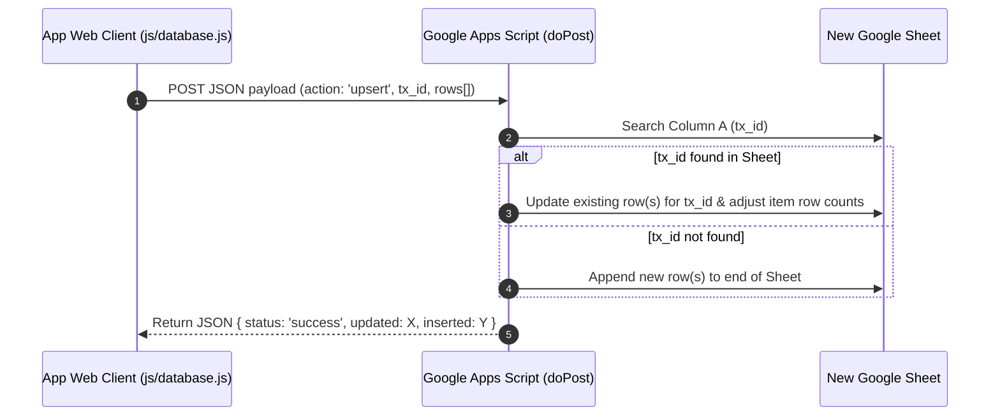

# Design Document: Auto Sync Google Sheets (Upsert & Excel Alignment)

**Date**: 2026-08-08  
**Project**: Voucher AMU (SPBU 74-961-4)  
**Status**: Proposed / Under Review  

---

## 1. Overview & Goals

System synchronization with Google Sheets needs to be upgraded to support a **new Google Sheet**, ensure **1:1 alignment with Excel export reports**, prevent **duplicate rows**, and support **updating edited receipts (nota)** without overwriting or destroying unrelated receipts in the sheet.

---

## 2. Requirements & Verification Criteria

1. **New Google Sheet Support**:
   - Provide clean configuration UI and default fallback for the Web App URL.
   - Provide a complete, ready-to-deploy Google Apps Script (`Code.gs`) script for the new Google Sheet.

2. **Format Alignment with Excel Export**:
   - The data columns written to Google Sheets must match the exact structure and formatting of the Excel export `REKAPITULASI TOTAL` table:
     1. `ID Transaksi` (hidden or column A for indexing)
     2. `No.`
     3. `No. Nota`
     4. `Tanggal` (DD/MM/YYYY)
     5. `Bulan` (Nama bulan Indonesia)
     6. `Tahun` (YYYY)
     7. `Nama Instansi`
     8. `Pecahan` (Voucher label e.g., "Voucher 100k")
     9. `Seri Awal`
     10. `Seri Akhir`
     11. `Lembar`
     12. `Subtotal Nominal`
     13. `Metode Pembayaran Voucher`
     14. `Admin`
     15. `Metode Pembayaran Admin`
     16. `Biaya Clearing`
     17. `Total`
     18. `Petugas / TTD`
     19. `Status`

3. **Deduplication (Prevent Duplicate Rows)**:
   - On the web app side: track transaction signature (`tx.id` + item fingerprint + update timestamp).
   - On the Google Apps Script side: check existing rows by `tx_id` and item index before appending. If row data is identical, skip writing.

4. **Edit Nota Upsert (Update In-Place)**:
   - When a receipt is edited (e.g. changing customer name, payment method, or voucher quantities), the client sends an `action: 'upsert'` payload.
   - Google Apps Script locates existing rows matching the `tx_id`.
   - It updates the existing rows for that `tx_id` in-place while leaving all other receipts untouched.
   - If the edited receipt has fewer items than before, excess rows for that `tx_id` are removed cleanly.

---

## 3. System Architecture & Data Flow



---

## 4. Google Apps Script Implementation (`Code.gs`)

Below is the production Apps Script code to be set up in the new Google Sheet:

```javascript
function doPost(e) {
  var lock = LockService.getScriptLock();
  lock.tryLock(10000);

  try {
    var sheet = SpreadsheetApp.getActiveSpreadsheet().getActiveSheet();
    ensureHeaders(sheet);

    var data = JSON.parse(e.postData.contents);
    var rows = Array.isArray(data) ? data : (data.rows || [data]);
    if (rows.length === 0) {
      return responseJSON({ status: 'success', message: 'No rows provided' });
    }

    var lastRow = sheet.getLastRow();
    var existingData = lastRow > 4 ? sheet.getRange(5, 1, lastRow - 4, 19).getValues() : [];
    
    // Group incoming rows by tx_id
    var txGroups = {};
    rows.forEach(function(row) {
      var txId = row.id || row.tx_id || '';
      if (!txId) return;
      if (!txGroups[txId]) txGroups[txId] = [];
      txGroups[txId].push(row);
    });

    for (var txId in txGroups) {
      var incomingTxRows = txGroups[txId];
      // Find existing row indices for this txId (1-indexed sheet row numbers)
      var matchingSheetRowIndices = [];
      for (var i = 0; i < existingData.length; i++) {
        if (String(existingData[i][0]) === String(txId)) {
          matchingSheetRowIndices.push(i + 5); // offset by 4 header rows
        }
      }

      if (matchingSheetRowIndices.length > 0) {
        // UPDATE existing rows for this transaction ID
        var firstRowIdx = matchingSheetRowIndices[0];
        var existingCount = matchingSheetRowIndices.length;
        var newCount = incomingTxRows.length;

        // If count matches or new is smaller/equal, overwrite
        for (var j = 0; j < newCount; j++) {
          var targetRow = firstRowIdx + j;
          if (j < existingCount) {
            sheet.getRange(targetRow, 1, 1, 19).setValues([formatRowData(incomingTxRows[j], j + 1)]);
          } else {
            sheet.insertRowAfter(firstRowIdx + j - 1);
            sheet.getRange(targetRow, 1, 1, 19).setValues([formatRowData(incomingTxRows[j], j + 1)]);
          }
        }
        // If previous count had more rows, delete extra obsolete rows
        if (existingCount > newCount) {
          for (var k = existingCount - 1; k >= newCount; k--) {
            sheet.deleteRow(firstRowIdx + k);
          }
        }
      } else {
        // INSERT new rows for this transaction ID
        incomingTxRows.forEach(function(r, idx) {
          sheet.appendRow(formatRowData(r, idx + 1));
        });
      }

      // Refresh existingData snapshot for subsequent iterations if any
      lastRow = sheet.getLastRow();
      existingData = lastRow > 4 ? sheet.getRange(5, 1, lastRow - 4, 19).getValues() : [];
    }

    return responseJSON({ status: 'success', processed: rows.length });
  } catch (err) {
    return responseJSON({ status: 'error', message: err.toString() });
  } finally {
    lock.releaseLock();
  }
}

function responseJSON(obj) {
  return ContentService
    .createTextOutput(JSON.stringify(obj))
    .setMimeType(ContentService.MimeType.JSON);
}

function ensureHeaders(sheet) {
  if (sheet.getLastRow() < 4) {
    sheet.clear();
    // Kop Surat
    sheet.getRange("A1:S1").merge().setValue("PT. ARBA MITRA USAHA GORONTALO (SPBU 74-961-4)")
      .setFontWeight("bold").setFontSize(14).setFontColor("#E2231A").setHorizontalAlignment("center");
    sheet.getRange("A2:S2").merge().setValue("LAPORAN PENJUALAN VOUCHER - SINKRONISASI OTOMATIS")
      .setFontWeight("bold").setFontSize(12).setHorizontalAlignment("center");
    sheet.getRange("A3:S3").merge().setValue("Sistem Otomasi Voucher & Nota Kwitansi | SPBU 74-961-4")
      .setFontItalic(true).setFontSize(10).setFontColor("#64748B").setHorizontalAlignment("center");
    
    // Header Row
    var headers = [
      "ID Tx", "No.", "No. Nota", "Tanggal", "Bulan", "Tahun", 
      "Nama Instansi", "Pecahan", "Seri Awal", "Seri Akhir", "Lembar", 
      "Subtotal Nominal", "Metode Pembayaran Voucher", "Admin", 
      "Metode Pembayaran Admin", "Biaya Clearing", "Total", "Petugas / TTD", "Status"
    ];
    sheet.getRange(4, 1, 1, headers.length).setValues([headers])
      .setBackground("#E2231A").setFontColor("#FFFFFF").setFontWeight("bold").setHorizontalAlignment("center");
    sheet.setFrozenRows(4);
  }
}

function formatRowData(row, itemNo) {
  return [
    row.id || '',
    itemNo || 1,
    row.nota_number || '',
    row.date_formatted || '',
    row.month_name || '',
    row.year_str || '',
    row.customer_name || '',
    row.voucher_label || '',
    row.start_serial || '',
    row.end_serial || '',
    Number(row.sheets) || 0,
    Number(row.subtotal_nominal) || 0,
    row.payment_voucher || 'Tunai',
    Number(row.admin_fee) || 0,
    row.payment_admin || 'Tunai',
    Number(row.clearing_fee) || 0,
    Number(row.total_amount) || 0,
    row.officer_name || '',
    row.status || 'SUKSES'
  ];
}
```

---

## 5. Frontend Code Updates

1. **`js/database.js`**:
   - Align `syncGoogleSheetsTransaction` payload generation 100% with `ExcelExport.exportToExcel` field formatting.
   - Send `tx_id` and item index in every row item payload.
   - Update `markGSheetsItemSynced` to track updated signature so edits re-sync cleanly without duplicate entries.
   - Add clear resync functionality for clean sync.

2. **`js/excel-export.js`**:
   - Shared helper functions used by both Excel Export and Google Sheets sync for date parsing (`parseDateFields`) and voucher label formatting (`getVoucherLabel`).

3. **`index.html` & `js/app.js`**:
   - Provide easy UI to change Google Apps Script URL.
   - Display modal/instructions for setting up the new Google Sheet.

---

## 6. Verification & Test Plan

- **Test Case 1**: Create a new transaction in the web app -> Verify Google Sheet receives row(s) matching Excel format 1:1.
- **Test Case 2**: Re-trigger sync for the same transaction -> Verify NO duplicate row is created in Google Sheet.
- **Test Case 3**: Edit an existing receipt (change payment method / customer / items) -> Verify Google Sheet updates the matching row(s) for that receipt without creating new rows and without touching other receipts.
- **Test Case 4**: Compare downloaded Excel file columns with Google Sheet columns -> Verify exact match in columns and calculations.
